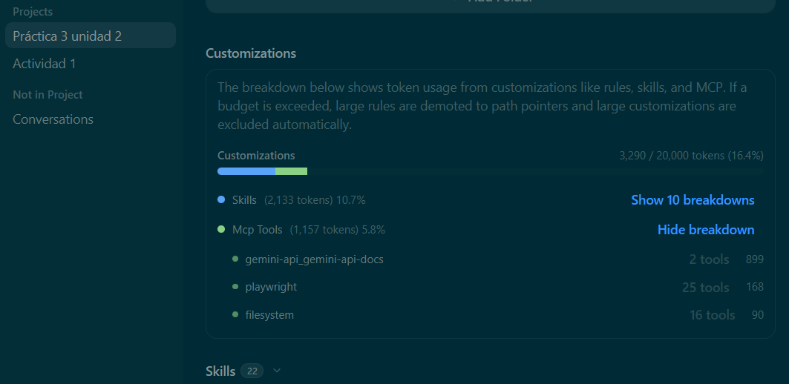
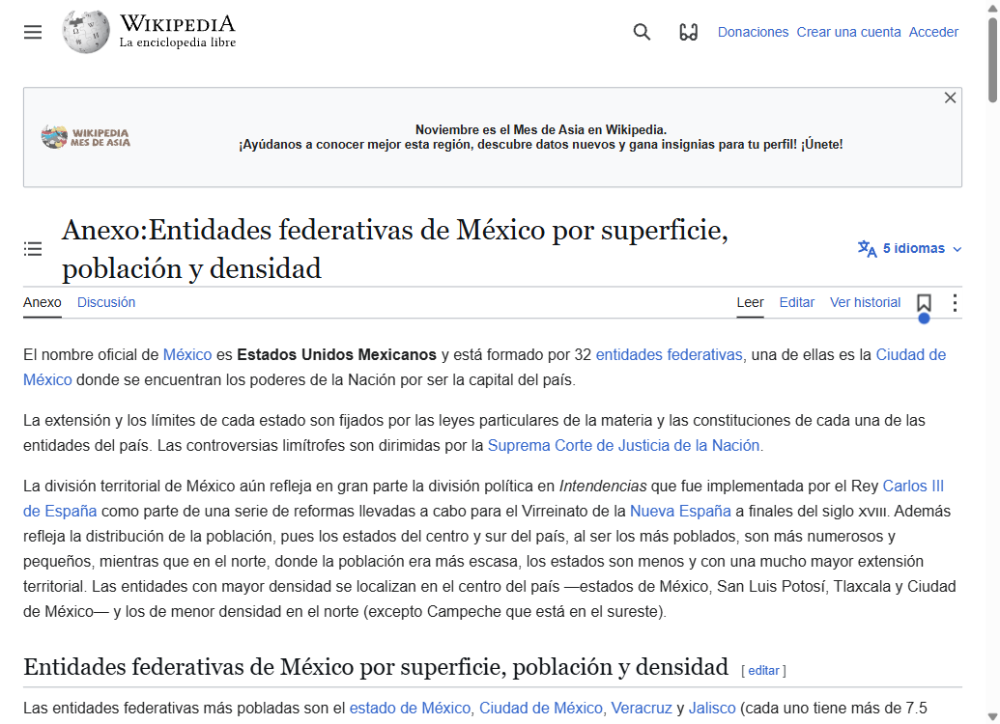

# Práctica 1: Conectar Servidores MCP a un Agente

## 1. Descripción
Esta práctica implementa la integración y uso del **Model Context Protocol (MCP)** en un entorno de desarrollo asistido por Inteligencia Artificial. A través de este protocolo estándar y abierto, un agente de programación puede conectarse a capacidades del sistema operativo y herramientas externas mediante una arquitectura cliente-servidor desacoplada.

* **Agente utilizado:** Google Antigravity IDE (Agent Mode).
* **Entorno operativo:** Windows 11 Pro 64-bit.
* **Versión de Node.js:** v26.13.1 (incluye `npx`).
* **Control de versiones:** Git version 2.55.0.windows.5.

---

## 2. Requisitos y Reproducción

### Requisitos previos
1. **Node.js 18 o superior** (LTS recomendado de [nodejs.org](https://nodejs.org)).
2. **Git** ([git-scm.com](https://git-scm.com)).
3. **Navegador web compatible con Playwright:** Google Chrome o Chromium (`npx playwright install chromium`).
4. **Google Antigravity IDE** (o Antigravity CLI / Claude Code).

### Pasos para reproducir la práctica desde cero

1. **Clonar el repositorio:**
   ```bash
   git clone <URL_DE_TU_REPOSITORIO> practica1-mcp
   cd practica1-mcp
   ```

2. **Crear o validar la estructura de carpetas:**
   ```bash
   mkdir datos salida instrucciones evidencias .agents
   ```

3. **Configurar la ruta absoluta en `.agents/mcp_config.json`:**
   Abre el archivo [`.agents/mcp_config.json`](.agents/mcp_config.json) y actualiza el argumento de ruta en el servidor `filesystem` sustituyendo `TU_USUARIO` por tu usuario local de Windows:
   ```json
   "filesystem": {
     "command": "cmd",
     "args": [
       "/c",
       "npx",
       "-y",
       "@modelcontextprotocol/server-filesystem",
       "C:\\Users\\TU_USUARIO\\OneDrive\\Documentos\\Programas Python\\Práctica 3 unidad 2"
     ]
   }
   ```
   > **Nota de Privacidad:** Por directriz de seguridad, en el repositorio público se ha sustituido el nombre de usuario local por el marcador de posición `TU_USUARIO`. Cada usuario debe indicar la ruta absoluta de su propia carpeta de trabajo antes de arrancar los servidores.

4. **Copiar o enlazar a la configuración global de Antigravity (si aplica en Windows):**
   Si Antigravity lee los servidores desde el archivo de configuración global del usuario, replica el contenido de `.agents/mcp_config.json` en `%USERPROFILE%\.gemini\config\mcp_config.json`.

5. **Recargar servidores MCP:**
   En Antigravity IDE, abre el panel de **MCP Servers** y haz clic en el botón de **Recargar** (o presiona `Ctrl+Shift+P` $\rightarrow$ `Developer: Reload Window`).

---

## 3. Servidores MCP

Se configuraron tres servidores MCP locales comunicándose a través del transporte bidireccional estándar **`stdio`** (Standard Input/Output) y mensajes JSON-RPC 2.0. En Windows, las herramientas basadas en Node se ejecutan con el prefijo `cmd /c npx` para evitar políticas de restricción de scripts de PowerShell.



### 1. `filesystem`
* **Paquete npm:** `@modelcontextprotocol/server-filesystem`
* **Publicado por:** Mantenedores oficiales del Model Context Protocol (Anthropic / Linux Foundation).
* **Propósito:** Proporciona capacidades seguras de lectura, escritura, inspección y navegación sobre el sistema de archivos local, estrictamente contenidas dentro de los directorios autorizados en su inicio (`allowedDirectories`).
* **Herramientas expuestas (16):**
  `list_directory`, `list_directory_with_sizes`, `directory_tree`, `read_file`, `read_text_file`, `read_media_file`, `read_multiple_files`, `write_file`, `append_file`, `edit_file`, `create_directory`, `move_file`, `copy_file`, `search_files`, `get_file_info`, `list_allowed_directories`.

### 2. `playwright`
* **Paquete npm:** `@playwright/mcp@latest`
* **Publicado por:** Microsoft Corporation.
* **Propósito:** Control y automatización de navegadores web basados en Chromium para inspección visual, lectura de DOM, ejecución de scripts en el navegador y captura de pantallas.
* **Herramientas expuestas (25):**
  `browser_navigate`, `browser_navigate_back`, `browser_snapshot`, `browser_click`, `browser_hover`, `browser_type`, `browser_fill_form`, `browser_select_option`, `browser_drag`, `browser_drop`, `browser_press_key`, `browser_wait_for`, `browser_evaluate`, `browser_run_code_unsafe`, `browser_take_screenshot`, `browser_resize`, `browser_close`, `browser_tabs`, `browser_file_upload`, `browser_handle_dialog`, `browser_console_messages`, `browser_network_requests`, `browser_network_request`, `browser_emulate_media`, `browser_find`.

### 3. `sequential-thinking`
* **Paquete npm:** `@modelcontextprotocol/server-sequential-thinking`
* **Publicado por:** Model Context Protocol (Anthropic / MCP Org).
* **Propósito:** Razonamiento estructurado paso a paso mediante pensamientos dinámicos, revisiones y derivaciones lógicas sucesivas.
* **Herramientas expuestas (1):**
  `sequentialthinking`.

---

## 4. Actividades A, B y C

### Actividad A: Lectura y Procesamiento de Calificaciones

* **Instrucción dada al agente (`instrucciones/actividad_a.txt`):**
  ```text
  Usa unicamente las herramientas del servidor MCP filesystem.
  1) Lista el contenido de la carpeta datos.
  2) Lee datos/calificaciones.csv.
  3) Calcula el promedio final de cada alumno (media de los tres parciales, con dos decimales) e indica si aprueba (promedio >= 6.0).
  4) Escribe el resultado en salida/reporte.md como una tabla Markdown ordenada de mayor a menor promedio, y al final agrega el promedio del grupo.
  Responde con un resumen breve de lo que hiciste.
  ```

* **Secuencia de herramientas MCP invocadas y orden:**
  1. `filesystem.list_directory` (argumento: `{"path": "datos"}`) $\rightarrow$ Retornó `[FILE] calificaciones.csv`.
  2. `filesystem.read_text_file` (argumento: `{"path": "datos/calificaciones.csv"}`) $\rightarrow$ Obtuvo los 8 registros de calificaciones.
  3. *Procesamiento computacional:* Cálculo de promedios individuales y general por el LLM.
  4. `filesystem.write_file` (argumentos: `path: "salida/reporte.md"`, `content: ...`) $\rightarrow$ Generó el reporte ordenado en Markdown.
  5. `filesystem.read_text_file` (argumento: `{"path": "salida/reporte.md"}`) $\rightarrow$ Verificó la persistencia y formato.

* **Resultado obtenido:**
  Se generó exitosamente [`salida/reporte.md`](salida/reporte.md).
  * **Alumnos aprobados (6):** Carla Mendez (9.50), Gabriela Luna (9.50), Ana Torres (9.00), Elena Castro (8.17), Fabian Ortiz (6.83), Bruno Salas (6.17).
  * **Alumnos no aprobados (2):** Diego Ruiz (5.50), Hector Vega (5.33).
  * **Promedio grupal:** **7.50**.

---

### Actividad B: De una Página Web a un CSV

* **Instrucción dada al agente (`instrucciones/actividad_b.txt`):**
  ```text
  Usa las herramientas MCP de playwright y filesystem.
  1) Abre en el navegador la pagina https://es.wikipedia.org/?curid=5897912
  2) Localiza la tabla principal con las 32 entidades federativas y extrae, para cada una: entidad, superficie en km2, poblacion y densidad (hab/km2).
  3) Guarda los datos en salida/entidades.csv con los encabezados entidad,superficie_km2,poblacion,densidad_hab_km2, con numeros sin separadores de miles y punto decimal.
  4) Toma una captura de pantalla de la pagina.
  5) Cierra el navegador.
  Responde con un resumen breve: cuantas filas guardaste y que año de poblacion usa la tabla.
  ```

* **Secuencia de herramientas MCP invocadas y orden:**
  1. `playwright.browser_navigate` (argumento: `{"url": "https://es.wikipedia.org/?curid=5897912"}`) $\rightarrow$ Carga de la página en Chromium.
  2. `playwright.browser_evaluate` $\rightarrow$ Localización de tablas en el DOM (identificación de la tabla 0 con 35 filas en total).
  3. `playwright.browser_evaluate` $\rightarrow$ Extracción y limpieza vía JavaScript de las 32 entidades federativas y sus métricas.
  4. `filesystem.write_file` (argumentos: `path: "salida/entidades.csv"`, `content: ...`) $\rightarrow$ **Cambio de servidor: en este paso (paso 4) el agente cambió de `playwright` a `filesystem` para escribir el archivo CSV**.
  5. `playwright.browser_take_screenshot` (argumento: `{"filename": "evidencias/02_actividad_b_web.png", "scale": "css"}`) $\rightarrow$ Almacenó la captura de evidencia.
  6. `playwright.browser_close` $\rightarrow$ Cierre seguro de la sesión de navegación.

* **Cómo obtuvo los datos de la tabla:**
  Mediante **ejecución de JavaScript (`browser_evaluate`)** directamente en el entorno de la página web. Se iteraron las filas `<tr>`, descartando los 3 encabezados iniciales, y se limpiaron los espacios no separables (`\u00A0`), notas al pie y separadores de miles, estructurando los valores directamente en cadenas CSV.

* **Resultado obtenido:**
  Se generó el archivo [`salida/entidades.csv`](salida/entidades.csv) con **32 entidades federativas** y 1 fila de encabezados.
  * **Año de población de la tabla:** **Estimación de 2020** (la columna de densidad poblacional está rotulada con base en datos de **2015**).

* **Verificación manual de 3 filas contra Wikipedia:**

| Entidad | Valor oficial en Wikipedia | Valor registrado en `salida/entidades.csv` | Verificación |
| :--- | :--- | :--- | :---: |
| **Chihuahua** | Superficie: 247 455 km²<br>Población: 3 741 869 hab.<br>Densidad: 14 hab./km² | `Chihuahua,247455,3741869,14` | Coincidencia exacta ✅ |
| **Sonora** | Superficie: 179 355 km²<br>Población: 2 944 840 hab.<br>Densidad: 16 hab./km² | `Sonora,179355,2944840,16` | Coincidencia exacta ✅ |
| **Coahuila** | Superficie: 151 562 km²<br>Población: 3 146 771 hab.<br>Densidad: 19 hab./km² | `Coahuila,151562,3146771,19` | Coincidencia exacta ✅ |

* **Evidencia visual:**
  

---

### Actividad C: Los Límites del Servidor Filesystem

* **Instrucción dada al agente (`instrucciones/actividad_c.txt`):**
  ```text
  Usa unicamente las herramientas del servidor MCP filesystem.
  1) Llama a list_allowed_directories.
  2) Intenta leer un archivo que este fuera de la carpeta de la practica (en Windows: C:/Windows/win.ini; en macOS o Linux: /etc/hosts).
  3) Intenta listar el directorio padre de tu carpeta permitida.
  No uses ninguna otra via si falla. Reporta textualmente que respondio el servidor en cada intento.
  ```

* **Secuencia de herramientas y respuestas exactas del servidor:**
  1. `filesystem.list_allowed_directories`:
     ```text
     Allowed directories:
     C:\Users\aldot\OneDrive\Documentos\Programas Python\Práctica 3 unidad 2
     ```
  2. `filesystem.read_text_file` hacia `C:/Windows/win.ini`:
     * **Mensaje de error textual devuelto por el servidor:**
     ```text
     Access denied - path outside allowed directories: C:\Windows\win.ini not in C:\Users\aldot\OneDrive\Documentos\Programas Python\Práctica 3 unidad 2
     ```
  3. `filesystem.list_directory` hacia `C:\Users\aldot\OneDrive\Documentos\Programas Python`:
     * **Mensaje de error textual devuelto por el servidor:**
     ```text
     Access denied - path outside allowed directories: C:\Users\aldot\OneDrive\Documentos\Programas Python not in C:\Users\aldot\OneDrive\Documentos\Programas Python\Práctica 3 unidad 2
     ```

* **¿Quién impuso el límite?:**
  **El servidor MCP (`filesystem`)**, no el modelo ni el host.
  * El **modelo (LLM)** intentó genuinamente realizar ambas peticiones enviando los argumentos solicitados.
  * El **host** simplemente enrutó la petición JSON-RPC al proceso hijo.
  * Fue el código del **servidor MCP** quien, antes de invocar cualquier llamada al sistema operativo de Windows, comparó la ruta normalizada contra su lista interna de directorios permitidos (`allowedDirectories`) y rechazó tajantemente la operación arrojando el error `Access denied`. Esto demuestra que la seguridad en la arquitectura MCP se aplica de manera determinista en el servidor y no depende de la falibilidad del LLM.

---

## 5. Actividad D: Tercer Servidor MCP (`sequential-thinking`)

* **Servidor elegido:** `@modelcontextprotocol/server-sequential-thinking`
* **Publicado por:** Anthropic y la comunidad de mantenedores oficiales de Model Context Protocol ([GitHub Oficial](https://github.com/modelcontextprotocol/servers)).
* **Herramientas que expone:** `sequentialthinking`.
* **Por qué se considera confiable:**
  Es un servidor desarrollado y publicado directamente por los creadores de la especificación MCP. Es de código abierto, no interactúa con recursos externos no autorizados ni expone la red, y se ejecuta localmente mediante Node.js en un proceso aislado.

* **Tarea resuelta con el servidor:**
  Se solicitó al servidor un análisis estructurado en 3 fases secuenciales respecto a los riesgos de seguridad y defensas en MCP:
  1. **Pensamiento 1:** Análisis del riesgo de inyección de prompt indirecta (*indirect prompt injection*) cuando se combinan Playwright (navegación web no confiable) y Filesystem (escritura en disco).
  2. **Pensamiento 2:** Explicación de los mecanismos de contención duros de MCP (validación de `allowedDirectories` en el servidor y confirmación humana interactiva en modo `Ask` en el host).
  3. **Pensamiento 3:** Directrices de ingeniería para documentar el principio de menor privilegio (*least privilege*) y defensa en profundidad.

* **Secuencia de llamadas:**
  * `sequential-thinking.sequentialthinking` (Thought 1/3, `nextThoughtNeeded: true`)
  * `sequential-thinking.sequentialthinking` (Thought 2/3, `nextThoughtNeeded: true`)
  * `sequential-thinking.sequentialthinking` (Thought 3/3, `nextThoughtNeeded: false`)

---

## 6. Problemas Encontrados y Soluciones

Durante el desarrollo de la práctica en el entorno Windows 11 se presentaron tres desafíos técnicos reales:

1. **Bloqueo de scripts `npx.ps1` en PowerShell por directiva de ejecución (`ExecutionPolicy`):**
   * *Problema:* Al intentar invocar comandos de `npx` directamente en PowerShell, el sistema rechazó la ejecución indicando: `No se puede cargar el archivo npx.ps1 porque la ejecución de scripts está deshabilitada en este sistema (PSSecurityException)`.
   * *Solución:* Se adoptó la convención exigida para Windows de invocar el ejecutor a través de `cmd /c npx`, lo cual elude el wrapper de PowerShell y llama directamente al archivo batch/binario de Node.js.

2. **Antigravity priorizando el archivo de configuración global sobre el archivo local:**
   * *Problema:* Antigravity no inicializaba los servidores al agregarlos en `.agents/mcp_config.json` debido a que en Windows consulta primordialmente el archivo de configuración global del usuario ubicado en `%USERPROFILE%\.gemini\config\mcp_config.json`.
   * *Solución:* Se sincronizaron ambos archivos manteniendo idéntica la configuración de los servidores (`filesystem`, `playwright` y `sequential-thinking`), asegurando compatibilidad tanto en el entorno local de ejecución como en la portabilidad del repositorio.

3. **Error `Chromium distribution 'chrome' is not found` en Playwright MCP:**
   * *Problema:* Al arrancar el servidor `playwright` en un equipo donde Google Chrome no está instalado en la ruta por omisión (`AppData\Local\Google\Chrome\Application\chrome.exe`), el servidor MCP falló en su inicialización.
   * *Solución:* Siguiendo la sección 12 de la guía de la práctica, se descargó el binario de Chromium mediante `npx playwright install chromium` y se creó una unión de directorio (junction de Windows sin requerir elevación de administrador) hacia `%LOCALAPPDATA%\ms-playwright\chromium-1254\chrome-win64`, permitiendo que `@playwright/mcp@latest` detectara el ejecutable de Chromium inmediatamente y respondiera con código de salida 0.

---

## 7. Fuentes

* **Página de Wikipedia consultada (Actividad B):**
  [Anexo: Entidades federativas de México por superficie, población y densidad](https://es.wikipedia.org/?curid=5897912) (Wikipedia, la enciclopedia libre).
* **Documentación oficial del Model Context Protocol:**
  [https://modelcontextprotocol.io](https://modelcontextprotocol.io)
* **Documentación de MCP en Google Antigravity:**
  [https://antigravity.google/docs/mcp](https://antigravity.google/docs/mcp)
* **Repositorio de servidores oficiales de MCP:**
  [https://github.com/modelcontextprotocol/servers](https://github.com/modelcontextprotocol/servers)
* **Servidor Playwright MCP de Microsoft:**
  [https://github.com/microsoft/playwright-mcp](https://github.com/microsoft/playwright-mcp)
